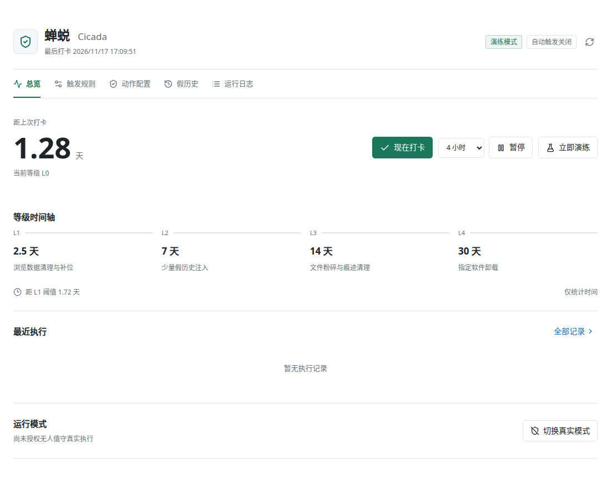

# 蝉蜕 Cicada · DSH 隐私维护插件

**浏览记录清理 · 指定文件夹删除 · 电脑使用记录清理 · 指定软件卸载 · 假历史补位**

如果有一天，你长时间没有使用电脑，也没有回来打卡，留下的浏览记录、私密文件和软件该怎样处理？

蝉蜕 Cicada 把这些隐私维护动作放进 DeepSeek Harness，由你提前保存清理范围、设置时间并授权。当前版本按距上次打卡的天数分级执行，所有操作都能先演练，再查看记录。

## 一天未操作或未打卡后的自动保护

**目标场景，24 小时统一触发规则待实现。** 电脑连续一天没有操作，或者超过一天没有打卡时，按事先保存并授权的范围自动完成下面的动作。

1. **清空浏览器记录**，清理所选浏览器的访问历史，并按配置补入假历史。
2. **清空并删除磁盘上的指定文件夹**，递归处理其中的文件和子目录。
3. **清除电脑使用记录**，处理最近打开项目、跳转列表、缩略图缓存、运行记录等 Windows 使用痕迹。
4. **自动卸载指定软件**，按事先保存的软件名称执行卸载。

当前代码已经包含上述四类动作，采用手动打卡计时和四级阈值。键鼠空闲检测、一天到期后统一执行全部动作列为后续开发项。当前可将第一级设为 **1 天**，在未打卡满 24 小时后自动清理浏览记录，文件夹删除与软件卸载分别由后续等级触发。首次安装默认使用**演练模式**，真实自动执行需由所有者另行授权。[一天阈值的配置方法](docs/usage.md#将浏览记录清理阈值设为一天)

## 灵感来自 Opera GX 的 Fake My History

Opera GX 的 **Fake My History** 提供了一个很直观的思路。在历史记录页点击 **Redeem my soul（赎回我的灵魂）** 并启用后，连续 **14 天未使用浏览器**，原有浏览历史会被清除，再由一组预设的虚构访问记录替换，降低私人浏览记录意外暴露带来的尴尬。[Opera GX 官方说明](https://www.opera.com/gx/features/fake-my-history)

Cicada 借鉴了这种“清理后补入假历史”的方式，并将维护范围扩展到指定文件夹、Windows 使用记录和指定软件。当前支持 **Chrome、Edge**，可按程序员、学生、设计师、投资者、游戏玩家、日常生活六种人设生成记录。第一级清理后可补入覆盖过去 **14 天** 的假历史，触发时间由你设置的打卡阈值决定。

## 界面预览



_总览使用演示数据。图中的第一级阈值已调为 2.5 天，首次安装默认为 3 天。_

## 当前版本的执行规则

四级规则按距上次打卡的天数触发，每一级的阈值和动作都可在管理页配置。修改后的阈值须严格递增。

| 等级 | 默认阈值 | 配置启用时的动作                                |
| ---- | -------- | ----------------------------------------------- |
| L1   | 3 天     | 清理浏览数据，并补入 14 天假历史                |
| L2   | 7 天     | 注入少量假历史                                  |
| L3   | 14 天    | 递归删除指定文件夹及内容，清理 Windows 使用记录 |
| L4   | 30 天    | 卸载指定软件                                    |

Windows 使用记录清理涵盖最近项目、跳转列表、缩略图和图标缓存、预读文件、运行框与资源管理器地址栏记录、DNS 缓存和回收站，执行结果取决于当前权限与文件占用情况。系统事件日志清理默认关闭。

管理页包含总览、触发规则、动作配置、假历史和运行日志。只有打卡会重置计时，键鼠活动和暂停期间仍累计距上次打卡的时长。插件随 Harness 运行，宿主重新启动时评估已到期等级。

## 版本兼容

在 PowerShell 运行 `dsh --version`，按完整版本号选择。

| 你的 DSH 版本 | Cicada 状态                                                                                                 |
| ------------- | ----------------------------------------------------------------------------------------------------------- |
| `0.2.2-rc.1`  | 对应历史插件 `0.1.2`，已有 Windows 本机 Web 宿主验收记录。 |
| `0.2.2-rc.5`  | 对应当前插件 `0.1.3`。Windows 本机 Web 验收范围和运行记录见[验证记录](docs/verification.md)。 |
| 其他版本      | 旧版配对和新宿主试配流程见[宿主升级方案](docs/compatibility.md)。                                           |

## 安装并完成第一次演练

以下步骤适用于首次安装 `0.1.3`。准备 Windows、DSH `0.2.2-rc.5` 和 Node.js **24.9+**。已有 Cicada 数据的用户请先关闭自动触发，确认保存成功后再换包。旧授权和打卡计时可能随配置保留。[已有安装的升级步骤](docs/usage.md#安装升级与卸载)

**1. 下载安装包。** 在发布页下载 `dsh-cicada-0.1.3.tgz` 和 `SHA256SUMS.txt`，用 PowerShell 核对摘要。需要自行构建时，按[开发与验证](docs/development.md)操作。[下载 v0.1.3](https://github.com/fiatlux2333/dsh-Cicada/releases/tag/v0.1.3)

```powershell
Get-FileHash 'C:\path\dsh-cicada-0.1.3.tgz' -Algorithm SHA256
```

**2. 安装到你平时打开的 DSH profile。** 先退出该 profile 的宿主，再将路径替换为刚下载的包。示例使用 `desktop`，使用其他 profile 时替换这个名称。

```powershell
dsh plugin --profile desktop add 'C:\path\dsh-cicada-0.1.3.tgz'
```

**3. 查看第一条演练记录。** 重新启动该 profile，在「插件」中启用 `dsh-cicada`。输入 `/cicada open` 打开总览，确认右上角显示「演练模式」和「自动触发关闭」。点击「立即演练」，在「最近执行」查看标为「演练」的记录。这个按钮只生成计划。**「动作配置」中的「全流程真实执行」会在所有者确认后执行真实动作，即使总览显示演练模式。**

## 日常使用

| 想做什么               | 怎么做                                                                                                                   |
| ---------------------- | ------------------------------------------------------------------------------------------------------------------------ |
| 查看距离下一级还有多久 | 输入 `/cicada open` 看总览时间轴。只想看当前等级和沉默天数时，输入 `/cicada status`。                                    |
| 打卡并开始新周期       | 在总览点「现在打卡」，或输入 `/cicada checkin`。每日提醒默认为本地时间 21 点，可在「触发规则」调整。                     |
| 暂停几个小时           | 输入 `/cicada pause 4` 暂停 4 小时，可选 1、4、8、24 小时。`/cicada resume` 提前恢复。暂停期间仍按上次打卡时间累计天数。 |
| 查看规则和结果         | 在「触发规则」查看四级阈值，默认为 3、7、14、30 天。在「运行日志」回看演练和执行记录。                                   |

当前可在「触发规则」把 L1 设为 **1 天**，保留 L2 / L3 / L4 为 **7 / 14 / 30 天**。首次安装保留 Cookies。模型工具提供脱敏状态、历史样本预览和演练，真实执行权限由本机所有者管理。停止设置若保存失败，请保持当前宿主运行，重试并确认保存成功后再退出。[安全与行为](docs/safety.md)

## DSH 更新以后

维护者可在已安装依赖的源码目录，用一个精确版本号准备候选包。

```powershell
pnpm compat:prepare 0.2.2-rc.5
```

命令会在独立目录对齐 SDK、Cordis 和 Zod，更新锁文件并执行预检，最后输出工作目录。进入该目录即可继续构建和演练。候选包仅支持演练，正式支持范围以分发包声明和对应的宿主验收记录为准。[升级与 CI 流程](docs/compatibility.md) · [验证记录](docs/verification.md)

## 文档与反馈

- [使用指南](docs/usage.md)涵盖配置、旧版数据导入、卸载与故障处理。
- [开发与验证](docs/development.md)说明如何启动合成界面预览、运行测试和打包。[更新日志](CHANGELOG.md)记录各版本的变化。
- 反馈问题时，请附插件和 DSH 的完整版本号，以及用演示数据重现问题的步骤。请隐去目标路径、凭据和所有者访问地址。[GitHub Issues](https://github.com/fiatlux2333/dsh-Cicada/issues)

本项目用 TypeScript 实现原版 Cicada 的打卡与隐私维护功能。项目许可证尚未声明，依赖许可列在第三方声明中。[原版 Cicada](https://github.com/fiatlux2333/Cicada) · [第三方声明](THIRD_PARTY_NOTICES.md)

## 官方依据

[DSH 插件开发](https://deepseek-harness.github.io/deepseek-harness/develop/basic/) · [打包与安装](https://deepseek-harness.github.io/deepseek-harness/develop/basic/publish) · [API Gateway](https://deepseek-harness.github.io/deepseek-harness/reference/api-gateway) · [客户端模块](https://deepseek-harness.github.io/deepseek-harness/reference/subsystems/client-modules) · [Slots](https://deepseek-harness.github.io/deepseek-harness/reference/subsystems/slots) · [Typert](https://deepseek-harness.github.io/deepseek-harness/reference/subsystems/typert) · [Storage](https://deepseek-harness.github.io/deepseek-harness/reference/subsystems/storage)
